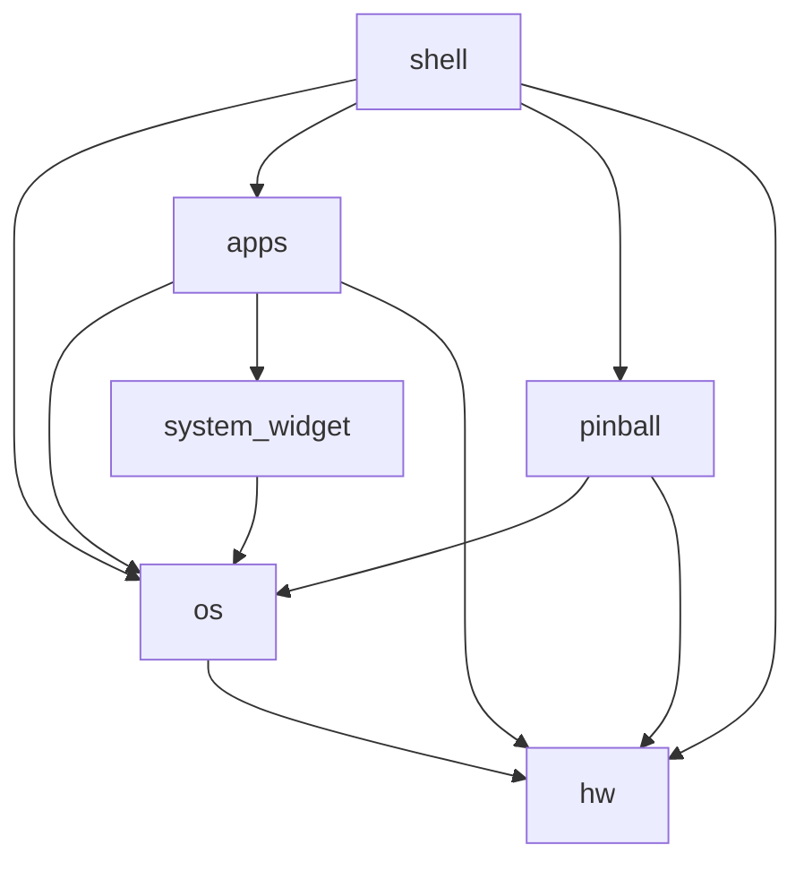

# ESP32-S3 Touch AMOLED 2.06 — Watch Firmware

A modular watch OS for the [Waveshare ESP32-S3 Touch AMOLED 2.06](https://www.waveshare.com/wiki/ESP32-S3-Touch-AMOLED-2.06) board, built on ESP-IDF v5.5.2 and LVGL 9.

## Project structure

```
watch/
├─ main/                        # App entry point only
│  ├─ main.c                    # thin: app_main() → watch_os_run()
│  ├─ lv_mem_custom.c           # LVGL PSRAM allocator (compiled into lvgl)
│  ├─ CMakeLists.txt            # main component + LVGL tuning
│  └─ idf_component.yml         # project-level managed dependencies
├─ components/
│  ├─ hw/                       # Hardware drivers (leaf layer)
│  │  ├─ hw_init.c              #   hw_init_all()
│  │  ├─ display/  touch/  power/  audio/  sensors/  rtc/  input/  actuator/
│  ├─ os/                       # Watch OS core + shared UI
│  │  ├─ app_config, app_events, app_power, app_wifi, app_time_region,
│  │  │  app_dictionary, app_ble_ancs, ble_ancs, app_notification_store,
│  │  │  app_notification_center, app_ui, app_lang
│  │  ├─ honeycomb_menu, icon_rearrange, list_view_menu   # launcher/menus
│  │  ├─ watch_faces/           #   registry + classic/minimal/flux + picker + ui/
│  │  ├─ wake_on_raise/         #   ESP-DL raise-to-wake classifier
│  │  ├─ services/              #   system activities (storage, capture, upload,
│  │  │                         #   USB MSC, file server, temp monitor, ...)
│  │  ├─ fonts/  lang/  png_images*  app_icon/  tools/   # shared assets
│  │  └─ tusb_config.h
│  ├─ system_widget/            # Reusable UI widgets (keyboard)
│  ├─ apps/                     # User-facing apps (one folder per app)
│  │  ├─ settings/  photo/  calculator/  noise/
│  ├─ pinball/                  # Space Cadet Pinball (game + port + UI + assets)
│  │  ├─ vendor/                #   vendored decompiled game core
│  │  ├─ port/                  #   ESP32 platform port + pinball_port.h
│  │  ├─ assets/                #   PINBALL_ENGLISH reference assets
│  │  └─ pinball_ui.c/h         #   LVGL app shell
│  ├─ shell/                    # Boot sequence + main loop (composition root)
│  │  └─ watch_os.c             #   watch_os_run()
│  ├─ esp-dl/                   # trimmed local ESP-DL (used by wake_on_raise)
│  └─ sdl_shim/                 # SDL shim for the pinball game
├─ spiffs/                      # SPIFFS image source (Linux FHS layout)
├─ sdcard/                      # demo JS apps for the SD card
├─ tools/                       # asset, OTA and calibration helper scripts
├─ assets/                      # watch-face source images used by tools/
├─ partitions.csv
└─ sdkconfig.defaults
```

### Dependency graph



- `hw` is the leaf hardware layer.
- `os` is the platform core (services, watch faces, launcher, shared assets).
- `apps` / `system_widget` / `pinball` build on top of `os`.
- `shell` is the composition root — it wires everything together and runs the
  main loop. `main.c` only calls `watch_os_run()`.

## Building

Requires **ESP-IDF v5.5.2** (the local checkout folder happens to be named
`ESP-IDF-v5.4.2`; the folder name does not affect the build).

Linux / macOS:

```bash
. "$IDF_PATH/export.sh"
idf.py set-target esp32s3
idf.py build
idf.py -p /dev/ttyACM0 flash monitor   # adjust the port
```

Windows PowerShell:

```powershell
. "$env:IDF_PATH\export.ps1"
idf.py set-target esp32s3
idf.py build
idf.py -p COM5 flash monitor           # adjust the port
```

On the first build the ESP-IDF Component Manager downloads everything listed
in `main/idf_component.yml` (plus transitive dependencies) into
`managed_components/`. The committed `dependencies.lock` pins the exact
versions, so no manual submodule setup is needed. `managed_components/` is
intentionally **not** committed.

The app binary is `build/lvgl_demo_v9.bin`.

## What is (and isn't) in this repository

Committed — everything needed to clone and build:

- `main/`, `components/`, `spiffs/`, `sdcard/`, `tools/`, `assets/`, `font/*.py`
- `CMakeLists.txt`, `partitions.csv`, `sdkconfig.defaults`, `dependencies.lock`

Not committed — private, generated, large, or third-party:

- `todo` — personal task notes
- `tmp/`, `screenshot/` — scratch files and generated screenshots
- `docs/` — vendor datasheets and a mirror of the Waveshare wiki; use the
  [board wiki](https://www.waveshare.com/wiki/ESP32-S3-Touch-AMOLED-2.06)
- `font/*.ttf` — font binaries; grab Noto Sans, Noto Sans JP, Noto Sans TC and
  Material Symbols from Google Fonts if you want to regenerate the font arrays
- `managed_components/` — fetched automatically by the component manager
- `build/`, `sdkconfig`, `.venv/`, `.vscode/`

## OTA updates (flash over WiFi — no cable)

The board uses a 32 MB flash.  The partition table has an 8 MB `factory`
slot plus a single 8 MB `ota_0` slot (and `otadata`), so the watch can
update itself over the network.

Flow:

1. **On the watch** — Settings → General → turn **OTA Updates** ON.  This
   also turns WiFi on (saved, so it auto-connects next boot).
2. Open **Settings → General → OTA Update**.  The page shows the watch's
   IP and a round **Install** button (gray spinner appears to its left
   while a firmware is being received).
3. **On your PC** — build then push the app image over WiFi:

   ```powershell
   idf.py build
   python tools/flash_ota.py <watch-ip>
   ```

   (or open `http://<watch-ip>:8081` in a browser and pick
   `build/lvgl_demo_v9.bin`).

4. When the upload finishes, the **Install** button becomes pressable.
   Tap it → the screen goes black with a big **WatchOS** title and a ring
   of 360 tiny round panels that fill white clockwise while installing →
   a spinner appears while the watch closes services (SD writes, config) →
   it reboots into the new firmware.

Notes:

- The updater always writes the *non-running* app partition, so updates
  keep working after the first reboot into `ota_0` (it alternates back
  into `factory`).
- `idf.py flash` via USB still works any time (it reflashes `factory` +
  `ota_0` + SPIFFS + bootloader).
- Storage stays 7 MB SPIFFS; the OTA slots each match the 8 MB factory
  app size.

## Adding an app

1. Create `components/apps/<your_app>/` with the app's `.c`/`.h` files (and any
   assets in the same folder).
2. Register it in `components/apps/CMakeLists.txt`:
   - add the source to `SRCS`, and the folder to `INCLUDE_DIRS`.
3. If the app needs an ESP-IDF/managed component, add it to `REQUIRES` and
   `components/apps/idf_component.yml`.
4. Add a launcher entry in `components/os/honeycomb_menu.c` (icon + open hook).
5. If it needs boot-time init, call it from `components/shell/watch_os.c`.

The app gets `app_config.h`, `app_events.h`, `hw_display.h`, `keyboard.h`, etc.
for free via the `os`, `hw` and `system_widget` components.

## Parallax 3D watch face

A Facebook-3D-style depth photo face (`Parallax`, id `WATCH_FACE_PARALLAX`).
It uses the **same pipeline as Facebook 3D photos**: a real **AI monocular depth
model** (Depth Anything V2, run ONCE on the PC) predicts an edge-aware depth map
(mountains/objects pop, not flat strips), then the photo is sliced along that
depth into layers. The ESP32-S3 only alpha-blends and slides already-decoded
images — it never runs the model or decodes anything in real time.

- **Build the layers** (downloads the portrait CC demo + the ~25 MB ONNX depth
  model on first run, then slices and **pre-decodes to raw LVGL bytes**):

  ```powershell
  python tools/parallax_face/build_parallax_face.py                          # portrait CC demo + AI depth
  python tools/parallax_face/build_parallax_face.py --input my.jpg           # your photo + AI depth
  python tools/parallax_face/build_parallax_face.py --input my.jpg --depth depth.png  # your own depth map
  python tools/parallax_face/build_parallax_face.py --no-ai                  # heuristic fallback
  ```

  Requires `numpy`, `pillow`, `onnxruntime` (`.venv`). Outputs
  `spiffs/usr/share/watchfaces/parallax/layerN.bin` (raw `RGB565` background + `RGB565A8` bands —
  the watch just reads them, **no on-device PNG decode**) + `meta.txt` + per-layer
  PNG previews in `tmp/parallax_face/` (inspect `parallax_depth.png` = the AI
  depth map). The default demo is a CC BY-SA photo; use `--input <your.png>`
  (e.g. a 410x502 portrait) to use your own. 6 layers of the full-screen
  (410x502) setup ≈ **2.26 MB PSRAM** with margin 26 / max-shift 24.

- **On-device**: `watch_face_parallax.c` reads each `.bin` into PSRAM as an
  `lv_image` (layer 0 = opaque full-photo background, 1..N-1 = alpha depth bands),
  and slides each one by a per-depth offset from the QMI8658 gravity tilt — the
  background moves least, the foreground most. Time/date/battery use the Minimal
  face's typography and position (no panel) over the full-bleed photo.

- **Tuning** (`watch_face_parallax.c` top): `PF_*` constants control the canvas,
  layer count, max shift (24 px), tilt range (25°) and the movement curve
  (`PF_FAR_FACTOR` 0.40 → `PF_NEAR_FACTOR` 0.85 — the background moves with the
  subject, so the near object doesn't dominate). They must match the Python tool's
  `--canvas-* / --layers / --margin / --max-shift`. This board has only ~2.7 MB
  PSRAM heap (the 5.6 MB firmware carves the rest), so full-screen layers are
  limited to ~6 — more layers need a smaller canvas or reclaimed PSRAM.
  Time/date use the Minimal face's typography (no panel).

## SPIFFS layout (Linux FHS)

The `storage` SPIFFS partition is mounted at `/spiffs` and follows the Linux
Filesystem Hierarchy Standard so it stays tidy as more data moves off flash:

```
/spiffs
├── etc/                    # system configuration
│   └── watch_config.json
├── usr/share/              # read-only application data
│   ├── dict/words.bin      #   keyboard dictionary (loaded into PSRAM at boot)
│   ├── lang/{en,jp,tc}.json
│   ├── watchfaces/          #   pre-decoded face bitmaps, loaded into PSRAM
│   │   ├── parallax/        #     parallax face layers
│   │   ├── flux_digit_0..9.bin   #     flux face digits
│   │   ├── ui_img_137261120.bin  #     classic face earth
│   │   └── ui_img_charge_png.bin #     charge icon
│   ├── activity/            #   activity app icons (loaded on first open)
│   ├── launcher/            #  (future) honeycomb icons
│   └── keyboard/            #  (future) keyboard glyphs
└── var/lib/                 # writable runtime state (created at boot)
    ├── battery_history.dat
    ├── screen_usage.dat
    └── wake_log.bin
```

SPIFFS images don't persist empty directories, so `/spiffs/var` and
`/spiffs/var/lib` are created at boot by `app_config_init()`.

Large pre-decoded images (flux digits, the classic face's earth + charge
icons, the Activity app icons) are no longer compiled into the firmware.
They live as raw `.bin` files under `/spiffs/usr/share/watchfaces/` and
`/spiffs/usr/share/activity/` and are loaded into PSRAM only while their
screen is shown, then freed — via `app_image_loader.c`.  Regenerate the
`.bin` files from the kept SquareLine sources with:

```
python tools/export_image_bins.py
```

This removed ~1.1 MB from the app binary (5.65 MB → 4.39 MB; app partition
free 33% → 46%) and makes those ~1.1 MB of PSRAM resident only while the
relevant screen is actually displayed.

## Notes

- **`tmp/`**, **`docs/`**, **`screenshot/`**, `font/*.ttf` and
  `managed_components/` are intentionally not committed (see
  "What is (and isn't) in this repository" above).
- **`spiffs/`** is the real SPIFFS image source and follows the Linux FHS
  layout (see "SPIFFS layout" below). `main/app/app_icon/` (icon PNGs) is *not*
  the SPIFFS image — it is the source for the generated icon arrays in
  `components/os/png_images*.c`.
- **Pinball** requires the original `PINBALL.DAT` on the SD card at
  `/sdcard/PINBALL.DAT`; see `components/pinball/port/README.md`.
- Icon/font regeneration scripts live in `components/os/tools/` and are
  path-relative, so they can be run from anywhere.
